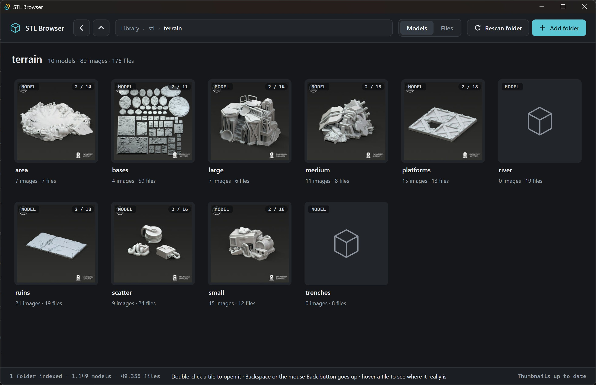

# STL Browser


A desktop app for Windows and macOS for browsing 3D-print collections: folders of STL, OBJ and LYS files and their
pictures, often packed in RAR, ZIP or 7Z archives that are nested inside other archives. You add folders to an index
and browse them like a file manager with very large icons. Each folder shows a carousel of the pictures inside it, and
you can drag anything out to Explorer to extract it, or use **Extract to…**.

Built with Rust and Tauri 2, with a Svelte 5 + TypeScript UI. **Windows and macOS.** Dragging files out works on
Windows only for now; on a Mac, use **Extract to…**.



## Features

- **Index:** added folders go into a SQLite index under `~/.stl-browser/`. Rescans are incremental, so unchanged folders
  take almost no time.
- **Archives:** ZIP, 7Z and RAR are read natively, so 7-Zip and WinRAR aren't needed. Archives nested inside other
  archives are read up to 3 levels deep. Password-protected archives show a padlock and are never opened.
- **Two views:** *Models* groups files into detected models with their images. *Files* shows the physical layout, with
  archives opened like folders.
- **Thumbnails:** images are scaled, and STL/OBJ meshes are rendered on the CPU. Folders get a picture carousel.
- **Drag-out and "Extract to…":** drag a model, file or folder straight out of an archive into Explorer (Windows), or
  extract it to a folder of your choice.
- **Search and tags:** search names below the open folder (Free, Word or Regexp), tag items yourself or use the
  generated support, scale, creator and edition tags, and search with `tag:` terms.
- **Multi-select:** select with Ctrl/Shift-click or a rubber band, then tag, drag or extract the selection together.

See [`docs/known-issues.md`](docs/known-issues.md) for known issues and ideas not built yet.

## Download

Every [latest release] has four files:

| File                                   | What it is                                                     |
|----------------------------------------|----------------------------------------------------------------|
| `stl-browser_<version>_x64-setup.exe`  | Windows installer                                              |
| `stl-browser-<version>.exe`            | Windows standalone executable; it runs without installing      |
| `stl-browser_<version>_universal.dmg`  | macOS disk image with the app (Apple Silicon and Intel)        |
| `stl-browser-<version>-macos`          | macOS bare executable (Apple Silicon and Intel), for Terminal  |

The Windows builds need Windows 10 or 11 with the WebView2 runtime, which Windows 11 already has. None of the builds are
code-signed, so Windows SmartScreen may warn you the first time you start it, and macOS blocks the app until you allow
it (see below).

To build from source instead, read on.

### macOS: opening an unsigned app

The Mac builds aren't signed with an Apple Developer ID or notarized by Apple, so Gatekeeper blocks them the first time.
You only have to allow the app once.

**The DMG (recommended):**

1. Open the DMG and drag **STL Browser** to **Applications**.
2. Start STL Browser from Applications. macOS says it could not verify that STL Browser is free of malware (on older
   versions: that it can't verify the developer). Click **Done** (or **Cancel**), not Move to Trash.
3. Within about an hour, open **System Settings → Privacy & Security**, scroll down to the message about STL Browser,
   and click **Open Anyway**. In the dialog that follows, click **Open Anyway** again and enter your password. If the
   button is gone, start the app once more and come back.

On macOS 14 (Sonoma) and earlier you can instead Control-click the app in Finder, choose **Open**, and click **Open**
again. macOS 15 and later removed that shortcut, so use Privacy & Security there.

Or, in Terminal, remove the quarantine flag that the browser put on the download:

```sh
xattr -dr com.apple.quarantine "/Applications/STL Browser.app"
```

**The bare executable:** a download loses its "executable" permission and gets quarantined, so in Terminal, in the
folder you downloaded it to:

```sh
chmod +x stl-browser-<version>-macos
xattr -d com.apple.quarantine stl-browser-<version>-macos
./stl-browser-<version>-macos
```

If `xattr` says "No such xattr", the file wasn't quarantined and that's fine. It runs without an app bundle, so it has
no proper Dock icon or name. Use the DMG unless you want a single file.

## Prerequisites

On Windows:

- Windows 10 or 11 with the [WebView2 runtime]. Windows 11 already has it.
- [Visual Studio Build Tools] with the **Desktop development with C++** workload. Tauri and the bundled `unrar` C++
  sources need it.
- [Rust] stable 1.85 or newer (the workspace uses edition 2024), with the default MSVC toolchain.

On macOS:

- Xcode Command Line Tools (`xcode-select --install`), for the C++ compiler.
- [Rust] stable 1.85 or newer, plus both Apple targets for the universal build:
  `rustup target add aarch64-apple-darwin x86_64-apple-darwin`.

On both:

- [Node.js] 20.19+ or 22.12+ (needed by Vite 8), with npm.

## Build a release binary

From the repository root:

```sh
npm --prefix app install
npm --prefix app run build:installer
```

This builds the Svelte UI and then the Rust app in release mode (LTO, so the first build takes a while). It produces:

| Output                                   | What it is                                 |
|------------------------------------------|--------------------------------------------|
| `target/release/app.exe`                 | The app itself; it runs without installing |
| `target/release/bundle/nsis/*-setup.exe` | NSIS installer (per-user, no admin needed) |

On macOS the same command builds a universal app (Apple Silicon and Intel, ad-hoc signed) and packs it in a disk image
at `target/universal-apple-darwin/release/bundle/dmg/STL Browser_<version>_universal.dmg`.

Tauri downloads NSIS on the first Windows build. Like `build:exe` below, `build:installer` remaps local source paths so the
binary doesn't embed paths from your machine (a plain `tauri build` doesn't). To build only the executable, skip the
installer:

```sh
npm --prefix app run build:exe
```

This skips the installer and also copies the exe to `target/release/stl-browser-<version>.exe`, with the version taken
from `app/src-tauri/tauri.conf.json`. On macOS it copies the universal binary to
`target/universal-apple-darwin/release/stl-browser-<version>-macos`. It also remaps local source paths (your Cargo home and the checkout) so the exe
doesn't embed paths from your machine.

## Releases

Releases are automatic. On every push to `main`, [commitizen] reads the [conventional commits] since the last tag and
picks the next version: `fix:` bumps the patch version, `feat:` the minor, and a breaking change the minor while the
version is 0.x. It updates the version in every file and in `CHANGELOG.md`, then commits and tags. The workflow then
builds the Windows exe and installer and the macOS binary and DMG, and attaches all four to a new GitHub release.
Pull requests run the tests on Windows and macOS. Don't change version numbers by hand. Check
what the next bump would be with `uvx --from commitizen cz bump --dry-run`.

## Run it

Start `target/release/app.exe` (or `stl-browser-<version>.exe`), or run the installer and start **STL Browser** from the
Start menu. On a Mac, start **STL Browser** from Applications.

1. Click **Add folder** and pick a folder with your collection, e.g. `D:\Models`.
2. Indexing runs in the background. The first index of a large collection can take a few minutes, mostly spent listing
   archives. Later rescans only look at what changed.
3. Browse in the *Models* or *Files* view. Drag items out to Explorer (Windows), or use **Extract to…**.

The app keeps its data in `%USERPROFILE%\.stl-browser\` on Windows and `~/.stl-browser/` on macOS:

- `index.db` holds the index plus your settings. Settings are kept when the listings are rebuilt.
- `thumbs\` is a thumbnail cache. You can delete it safely; thumbnails are regenerated.

Set the `STL_BROWSER_HOME` environment variable to use a different data folder, e.g. for testing.

## Development

```sh
npm --prefix app run tauri dev   # run the app with hot reload
cargo test --workspace           # Rust tests
npm --prefix app run check       # UI type check (svelte-check)
npm --prefix app test            # UI logic tests
cargo run --release -p stl-index --bin stlx -- add <dir>   # dev CLI: add, index, extract, tree, parity
```

[`CLAUDE.md`](CLAUDE.md) has the full command list and the project's rules and gotchas.

## Repository layout

| Path               | Contents                                                                     |
|--------------------|------------------------------------------------------------------------------|
| `crates/stl-core`  | Pure logic: file-name heuristics, the model resolver, the virtual tree views |
| `crates/stl-scan`  | Archive access (ZIP/7Z/RAR), nested listing, extraction, folder discovery    |
| `crates/stl-thumb` | Thumbnail generation: image scaling, STL/OBJ rendering, priority queue       |
| `crates/stl-drag`  | Windows OLE drag-out of virtual files (empty on macOS)                       |
| `crates/stl-index` | The SQLite index: schema, incremental scans, views, export; `stlx` CLI       |
| `app/src-tauri`    | The Tauri shell and its commands                                             |
| `app/src`          | The SvelteKit UI                                                             |

Design documents:

- [`docs/index.md`](docs/index.md): architecture, data on disk, invariants and testing. Start here.
- [`docs/features.md`](docs/features.md): how each feature works.
- [`docs/ui.md`](docs/ui.md): the UI's layout, components and theme.
- [`docs/archive-patterns.md`](docs/archive-patterns.md): archive layout patterns and the model resolver.
- [`docs/virtual-tree.md`](docs/virtual-tree.md): the Models and Files views and their naming rules.

## License

[MIT](LICENSE)

<!-- Links -->
[commitizen]: https://commitizen-tools.github.io/commitizen/
[conventional commits]: https://www.conventionalcommits.org/
[latest release]: https://github.com/mhvelplund/stl-browser/releases/latest
[Node.js]: https://nodejs.org/
[Rust]: https://rustup.rs/
[Visual Studio Build Tools]: https://visualstudio.microsoft.com/visual-cpp-build-tools/
[WebView2 runtime]: https://developer.microsoft.com/microsoft-edge/webview2/
